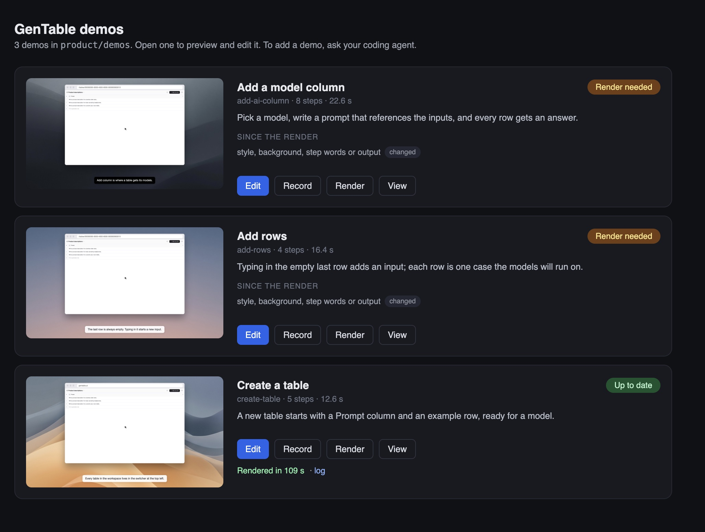
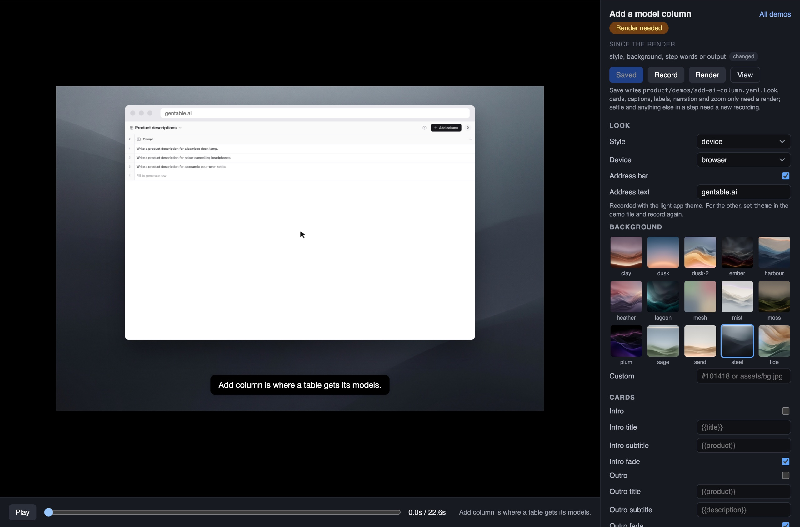

# Product demo

> Demo videos that regenerate themselves when the product changes.

A demo is a flow with a script. The script is a small YAML file in `/product/demos`, next to the Product Map. CI replays it against your app in a seeded demo mode, keeps keyframes plus an event log as the source, renders a video from them in the style you chose, and uploads it to a store your docs site reads. When code the demo depends on changes, that demo is regenerated, and only that one. Nothing generated is committed.

```text
/product/demos/add-task.yaml
        ↓ record (Playwright, demo mode)                  in CI
keyframes + events.json + manifest.json
        ↓ render (frame by frame, a style and background)
add-task.mp4 + poster + captions
        ↓ store (S3 / R2)
production/index.json            ← your docs site reads this
pr-123/index.json                ← previews for a pull request, deleted on close
```

## Why not screen recordings

A screen recording captures one machine on one day: dropped frames, a late tooltip, the real cursor path. Two recordings of the same steps never match, so a changed video tells you nothing. Keyframes and an event log hold everything the video needs and nothing that varies. Restyling is a render. Review is two PNGs side by side in the pull request comment.

## Styles, backgrounds, settings

Three styles: `neutral` (the page itself), `device` (inside a browser, laptop or phone on a background) and `perspective` (the device with a 3D tilt and parallax). The background is one of fifteen built-in wallpapers, a colour, or your own image. The app itself is recorded in a light or dark theme. Intro and outro cards, captions, cursor and output size are settings with defaults in config and overrides per demo. The camera is per step: a `zoom` on a step moves in on what it acted on, or on another element, in any style.

A local studio (`product-demo studio`) is the editor: it lists the demos with their status, previews any look from a recording without rendering, edits each step's label, narration and zoom, saves into the demo file, and records and renders from the page. Writing new demos stays with the coding agent and this skill; the studio has no model in it.





Voice-over comes from a `say` line per step, generated with a local model by default (no key) or a cloud voice, cached per sentence so only changed lines regenerate. The same lines are the captions.

## Staying current

Every recording collects browser coverage and maps it back to repository files, so the manifest knows which files the demo depends on, plus any server-side globs you add. `product-demo check` compares them with the working tree and names what changed. The workflow the skill installs regenerates stale demos into a pull request's own folder and comments with the keyframes and preview links, overwrites production on merge, and deletes the PR folder on close.

## Install

Any agent that reads `SKILL.md` (Claude Code, Codex, Cursor, and others). This installs only this skill; add `-g` to install it in your user directory instead of the project:

```bash
npx skills@latest add nuthinking/skills --skill product-demo
```

Claude Code, as a managed plugin (this installs all the skills in this repo), from inside a session:

```text
/plugin install nuthinking-skills --marketplace nuthinking/skills
```

Or from your shell:

```bash
claude plugin marketplace add nuthinking/skills
claude plugin install nuthinking-skills@nuthinking
```

Or copy the `product-demo` folder into your agent's skills directory (for example `.claude/skills/product-demo`).

## Use

Ask in plain language:

- "Set up demo videos for this app." (Install)
- "Make a demo of the checkout flow." (Add demo)
- "Are the demos still current?" or "CI says two demos are stale." (Regenerate)
- "The signup demo renders with the wrong font." (Diagnose)
- "Give the demos our brand colours and show them in a laptop." (Restyle)

The skill works best in a repo that has a Product Map (`product-map` skill): demos point at flows, borrow their node labels, and seed their dependency lists from the flows' implementation references. It works without one too.

## The package

[`@nuthinking/product-demo`](https://www.npmjs.com/package/@nuthinking/product-demo) holds the recorder, the renderer, the built-in wallpapers, the studio, the store client and the CLI. The commands it must provide are the contract in [`references/cli.md`](references/cli.md).

```bash
npm run product-demo -- validate          # structure, targets, references
npm run product-demo -- check             # which demos are stale, and why
npm run product-demo -- record add-task   # record one demo into .cache/
npm run product-demo -- render add-task   # a video from it
```

## What is in this folder

```text
product-demo/
  SKILL.md                     The skill: modes, what good looks like, diagnosis table
  references/
    format.md                  The file contract: config, demo scripts, steps, recordings, the store
    styles.md                  Styles, backgrounds, settings and the studio
    how-it-works.md            The pipeline, determinism, staleness, environments, review
    cli.md                     The commands the package provides
    ci.md                      The workflow and how to adapt it
    agent-instructions.md      The section added to AGENTS.md / CLAUDE.md
  scripts/
    validate.py                Structural validator for /product/demos, Python 3, no dependencies
    test_validate.py           Regression tests for the validator
```
